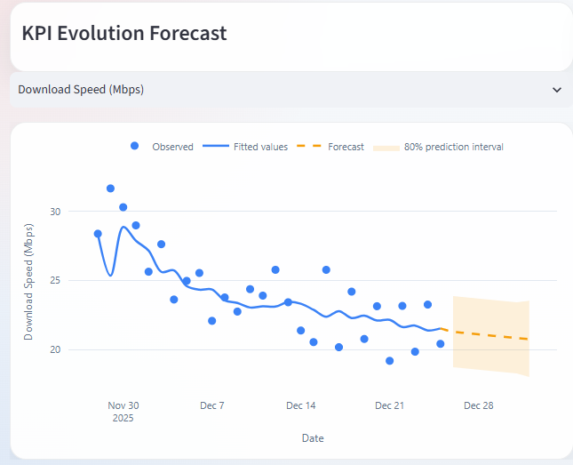
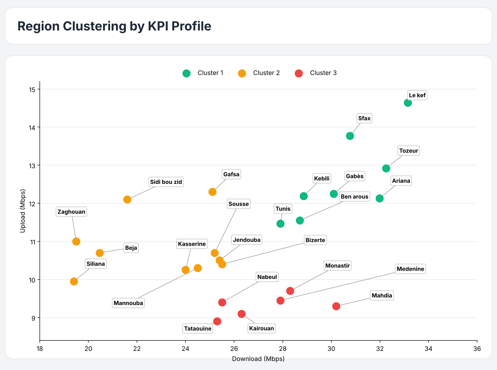
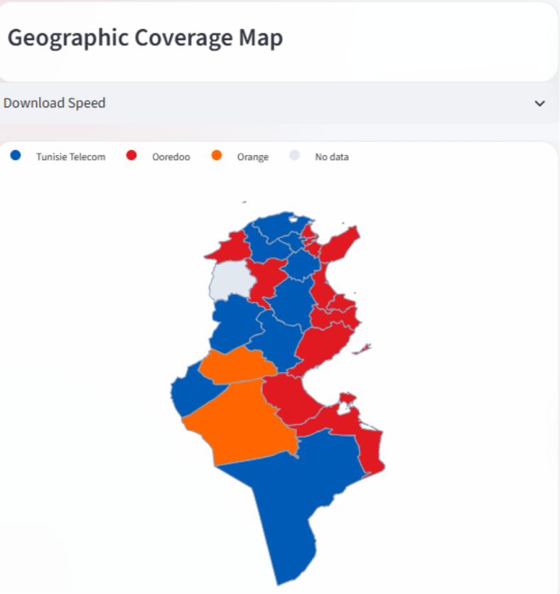

# Telecom Network Performance Dashboard

**Second-Year Engineering Internship Project — Tunisie Telecom**

An interactive Streamlit dashboard developed during my second-year engineering internship at **Tunisie Telecom**. The application analyses mobile network speed tests in Tunisia: it cleans raw test logs, compares operators, maps performance by governorate, forecasts KPIs and groups regions by network quality.

## Internship Context, Deployment & Confidentiality

This project was developed as part of my second-year engineering internship at **Tunisie Telecom**.

The application is deployed and runs locally as a standalone desktop application. It is not publicly hosted due to data confidentiality requirements and internal project constraints.

<figure style="text-align: center; margin: 0 0 32px;">
  
  <figcaption style="display: block; margin-top: 16px;"><strong>Interface and KPIs</strong></figcaption>
</figure>

<figure style="text-align: center; margin: 0 0 32px;">
  
  <figcaption style="display: block; margin-top: 16px;"><strong>KPI Evolution &amp; Forecast</strong></figcaption>
</figure>

<figure style="text-align: center; margin: 0 0 32px;">
  
  <figcaption style="display: block; margin-top: 16px;"><strong>Region Clustering by KPI Profile</strong></figcaption>
</figure>

<figure style="text-align: center; margin: 0 0 32px;">
  
  <figcaption style="display: block; margin-top: 16px;"><strong>Network Performance Map</strong></figcaption>
</figure>

<figure style="text-align: center; margin: 0 0 32px;">
  
  <figcaption style="display: block; margin-top: 16px;"><strong>Mobile Technology Generation Share</strong></figcaption>
</figure>

## Features

- **Data cleaning**: merges several CSV files, removes duplicates and invalid coordinates, standardizes operator, region (Tunisian governorates) and connection-type values.
- **Filters**: time range, operator and region.
- **KPI cards**: median download, median upload, average latency (interquartile mean), number of tests.
- **Geographic map**: performance by governorate for a selectable KPI.
- **Operator comparison**: speed bars, latency, multi-KPI radar (download, upload, latency, jitter, signal) and 4G/5G share.
- **KPI forecast**: 7-day forecast of download, upload, latency or jitter with an 80% prediction interval.
- **Region clustering**: groups governorates into speed tiers.

## Standalone Application

The application runs locally without requiring:

- An internet connection.
- A separate Python installation.
- Manual installation of third-party packages or dependencies.

The packaged application includes its own Python runtime and required dependencies, allowing it to run independently on the target machine.

## How the Analytics Work

### Forecasting (`backend/forecast.py`, validation in `backend/forecast_eval.py`)

- Daily median of each KPI (days with fewer than 5 tests are dropped), put on a complete daily calendar, with short gaps interpolated.
- `AutoTheta` model from `statsforecast`, weekly seasonality only when there are at least 14 daily points.
- Prediction interval widened with a conformal correction based on out-of-sample errors from rolling windows.
- Validation: rolling-origin backtest on held-out weeks against a "same as last week" baseline. Results are written to `output/forecast_evaluation.csv` and `.txt` after each upload.

**Example backtest on 28 days of data (2 windows of 7 days):**

| KPI | MAE (model) | MAE (last week) | Gain vs last week | 80% interval coverage |
|---|---:|---:|---:|---:|
| Download (Mbps) | 1.819 | 2.646 | +31.3% | 64.3% |
| Upload (Mbps) | 0.867 | 1.28 | +32.3% | 78.6% |
| Latency (ms) | 2.681 | 2.398 | -11.8% | 78.6% |
| Jitter (ms) | 0.398 | 0.407 | +2.2% | 71.4% |

The model beats the baseline on download and upload, is roughly equal on jitter and is worse on latency. With only 14 test points per KPI, coverage is noisy and should be read as close to 80%, not calibrated.

### Clustering (`backend/clustering.py`)

- One row per governorate: median download and upload, regions with fewer than 10 tests are excluded.
- Standardized features, Ward hierarchical clustering, number of clusters (2 to 7) chosen by silhouette score.
- Clusters are ranked from fastest to slowest and named accordingly.
- Exploratory tiering only: with about 24 regions and two correlated features, it describes the data and does not predict anything.

## Running the Application

The application is distributed as a standalone desktop application and can be launched directly on the local machine.

No Python installation, dependency setup or internet connection is required.

Once launched, users can upload one or more CSV files through the dashboard interface.

## Input Data

One CSV per day of mobile speed tests (one row per test). Main columns used:

| Purpose | Columns |
|---|---|
| Time | `ts_result` |
| Speed | `val_download_kbps`, `val_upload_kbps` |
| Quality | `val_latency_iqm_ms`, `val_jitter_ms`, `val_signal_rsrp_dbm`, `metric_packet_loss_percent` |
| Operator | `attr_isp_common_name` (Tunisie Telecom, Ooredoo, Orange; others grouped as "Other") |
| Location | `attr_place_region`, `attr_location_latitude`, `attr_location_longitude` |
| Technology | `attr_connection_type_end_string` |
| Identifier | `guid_result` (used for deduplication) |

The raw logs contain device identifiers, IP addresses and GPS positions. Therefore, **no raw data is included in this repository**. The `uploads/`, `output/` and all `.csv` files are git-ignored.

## Project Structure

```text
app.py                      Streamlit app (layout, filters, upload)
backend/
    cleaning.py             Cleaning and standardization
    charts.py               Operator charts and radar
    map.py                  Geographic map and region names
    forecast.py             KPI forecast chart
    forecast_eval.py        Rolling backtest, writes output/forecast_evaluation.*
    clustering.py           Region clustering chart
    eda.py                  Optional exploratory profiling script
assets/                     Logo and Tunisia governorates GeoJSON
fetch_geojson.py            One-time script that rebuilds the GeoJSON
requirements.txt
run.bat                     Windows launcher (uses a local portable Python)
```

## Author

**Wissem Hammami**

Third-Year Engineering Student — ESSAI, University of Carthage, Tunisia.